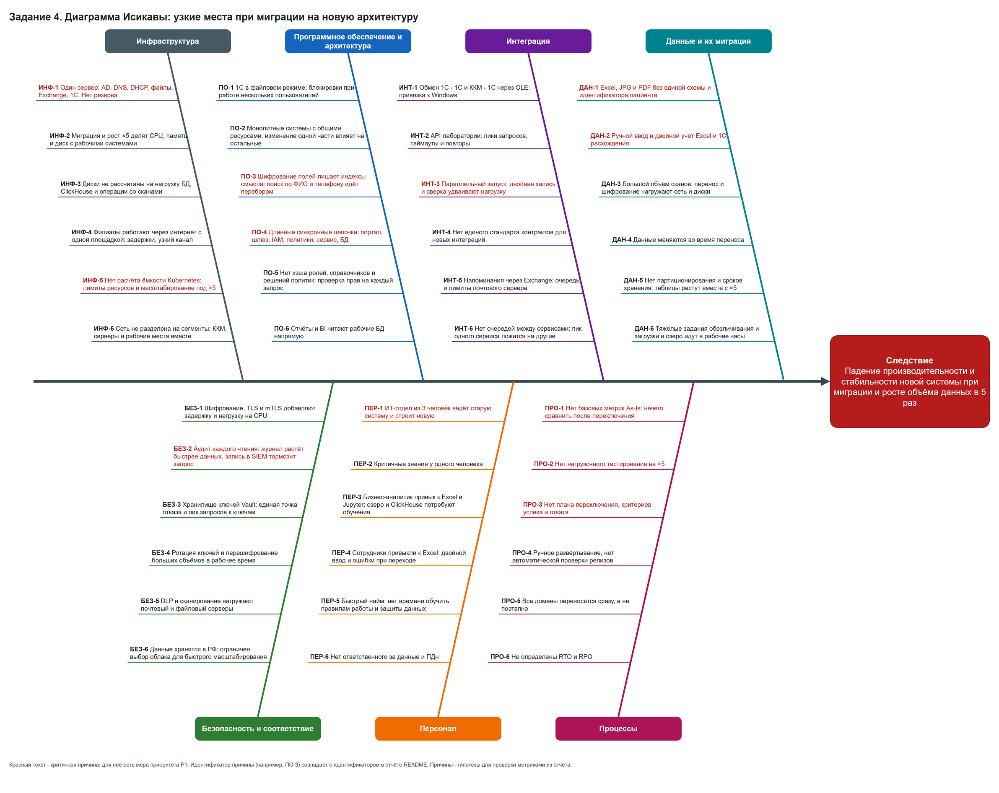

# Задание 4. Узкие места при миграции

Диаграмма Исикавы: [Ishikawa-bottlenecks.drawio](Ishikawa-bottlenecks.drawio) (открывается в draw.io), изображение ниже.

## 1. Ситуация и цель миграции

«Медикаменте» переходит от ручной работы в Excel, сканов на общем диске и файловых 1С к системе из сервисов: портал клиента и сотрудников, сервисы пациентов, записи и медицинских данных, API-шлюз, озеро обезличенных данных для аналитики (целевая архитектура описана в [Задании 2](../Task2/C4-MVP-context.png)).

Условия миграции:
- объём данных и число клиентов вырастут в 5 раз, откроются новые филиалы;
- команда будет активно расширяться;
- все системы сейчас работают на одном физическом сервере компании, в ИТ-отделе три человека;
- промежуточное состояние (MVP с самозаписью пациентов) нужно получить через пару месяцев, полный автоматический процесс - через год.

Узкое место - участок, который ограничивает производительность или стабильность всей системы. Задача: до начала миграции найти такие участки и заранее определить меры.

## 2. Компоненты и процессы, затронутые миграцией

| Компонент или процесс | Сейчас | Станет | Где возможно узкое место |
|---|---|---|---|
| Запись на приём | Журналы Excel, запись делает ресепшен | Портал клиента, сервис записи, напоминания | Пики записей, цепочка вызовов (ПО-4, ИНТ-6) |
| Данные пациентов и медицинские карты | Excel и папки на общем диске | Сервисы пациентов и медицинских данных с шифрованием | Поиск по зашифрованным полям, перенос данных (ПО-3, ДАН-1) |
| Платежи и кадры | 1С Бухгалтерия в файловом режиме, ККМ через OLE | 1С на PostgreSQL, обмен без OLE | Блокировки, OLE (ПО-1, ИНТ-1) |
| Склад | 1С Торговля и склад в файловом режиме | Клиент-серверный режим | Блокировки при росте пользователей (ПО-1) |
| Серверная инфраструктура | Один физический сервер | Kubernetes, собственные серверы, резерв | Ёмкость и единая точка отказа (ИНФ-1, ИНФ-5) |
| Интеграция с лабораторией | Нет | API через шлюз | Таймауты и пики (ИНТ-2) |
| Почта | Exchange | Exchange с DLP и напоминаниями | Очередь и нагрузка (ИНТ-5, БЕЗ-5) |
| Аналитика | Excel и Jupyter | Озеро ClickHouse, обезличивание (NiFi) | Конкуренция за ресурсы (ДАН-6, ПО-6) |
| Защита и аудит | Доменная аутентификация без аудита | Keycloak, Open Policy Agent, Vault, SIEM | Накладные расходы защиты (БЕЗ-1 - БЕЗ-5) |
| Команда и процессы | Три ИТ-специалиста, ручные операции | Кросс-функциональная работа, CI/CD | Нехватка людей и измерений (ПЕР-1, ПРО-1) |

## 3. Диаграмма Исикавы

Следствие: падение производительности и стабильности новой системы при миграции и росте данных в 5 раз. Причины разложены по семи категориям: инфраструктура, программное обеспечение и архитектура, интеграция, данные и их миграция, безопасность и соответствие, персонал, процессы.

Категория «Безопасность и соответствие» добавлена к стандартному набору. Защита из Заданий 1 - 3 (шифрование, аудит, проверка политик, ключи) расходует ресурсы системы, и без расчёта она сама становится узким местом.

Всего на диаграмме 42 причины. 12 из них отмечены как критичные.

## 4. Описание причин

Причины - гипотезы. Каждую можно подтвердить или опровергнуть метрикой из последнего столбца до начала миграции.

### Инфраструктура

| ID | Причина | Как проявится | Как выявить |
|---|---|---|---|
| ИНФ-1 | Один сервер: AD, DNS, DHCP, файлы, Exchange, 1С. Нет резерва (критично) | Сбой или перегрузка сервера останавливает вход в сеть, почту, 1С и файлы одновременно | Загрузка CPU, памяти и диска сервера (VictoriaMetrics), число простоев за период |
| ИНФ-2 | Миграция и рост ×5 делят CPU, память и диск с рабочими системами | Во время переноса данных замедляются Excel, 1С и почта у всех сотрудников | Метрики сервера в часы переноса и вне их, жалобы сотрудников на задержки |
| ИНФ-3 | Диски не рассчитаны на нагрузку БД, ClickHouse и операции со сканами | Растёт время запросов и записи, когда одновременно работают БД, резервное копирование и шифрование | IOPS, задержка и очередь диска, нагрузочный тест с реальным объёмом данных |
| ИНФ-4 | Филиалы работают через интернет с одной площадкой: задержки, узкий канал | Портал сотрудников и 1С в филиале отвечают медленнее, чем в центральном офисе | Задержка и потери пакетов по каналу, время отклика из филиала против центрального офиса |
| ИНФ-5 | Нет расчёта ёмкости Kubernetes: лимиты ресурсов и масштабирование под ×5 (критично) | Под нагрузкой поды упираются в лимиты, перезапускаются, очереди запросов растут | Нагрузочный тест на ×5 (k6, Gatling), метрики CPU, памяти и перезапусков подов |
| ИНФ-6 | Сеть не разделена на сегменты: ККМ, серверы и рабочие места вместе | Лишний трафик в общей сети, нельзя изолировать и приоритизировать обмен ККМ с сервером | Топология сети, объём трафика по сегментам, задержка обмена ККМ - 1С |

### Программное обеспечение и архитектура

| ID | Причина | Как проявится | Как выявить |
|---|---|---|---|
| ПО-1 | 1С в файловом режиме: блокировки при работе нескольких пользователей | С ростом числа пользователей документы проводятся медленнее, растёт число конфликтов блокировок. После перехода на клиент-сервер профиль нагрузки меняется | Время проведения документов, число блокировок и таймаутов, технологический журнал 1С |
| ПО-2 | Монолитные системы с общими ресурсами: изменение одной части влияет на остальные | Тяжёлая операция (например, отчёт) тормозит остальные, любое изменение требует проверки всей системы | Корреляция замедлений с конкретными операциями, карта зависимостей модулей |
| ПО-3 | Шифрование полей лишает индексы смысла: поиск по ФИО и телефону идёт перебором (критично) | Поиск пациента на ресепшене замедляется пропорционально числу записей, при ×5 это становится заметным | План выполнения запросов (EXPLAIN), время поиска на объёме ×5 |
| ПО-4 | Длинные синхронные цепочки: портал, шлюз, IAM, политики, сервис, БД (критично) | Задержки звеньев суммируются, сбой одного звена блокирует весь запрос | Распределённая трассировка, p95 времени ответа по каждому звену |
| ПО-5 | Нет кэша ролей, справочников и решений политик: проверка прав на каждый запрос | Keycloak и Open Policy Agent получают лишние запросы, их нагрузка растёт вместе с числом пользователей | Число запросов к IAM и политикам на одну операцию, доля повторяющихся решений |
| ПО-6 | Отчёты и BI читают рабочие БД напрямую | Формирование P&L, ABC-анализа и выгрузок замедляет запись на приём и оплату | Длинные запросы в рабочих БД по времени суток (pg_stat_statements, логи в Elastic) |

### Интеграция

| ID | Причина | Как проявится | Как выявить |
|---|---|---|---|
| ИНТ-1 | Обмен 1С - 1С и ККМ - 1С через OLE: привязка к Windows | Компонент OLE работает только на Windows, его нельзя масштабировать и вынести в Kubernetes, замена требует переработки интеграции | Инвентаризация интеграций 1С, время обмена и число ошибок обмена |
| ИНТ-2 | API лаборатории: пики запросов, таймауты и повторы | Медленный или недоступный партнёр блокирует потоки и копит очередь запросов на нашей стороне | Время ответа и доля ошибок по вызовам лаборатории, длина очереди |
| ИНТ-3 | Параллельный запуск: двойная запись и сверка удваивают нагрузку (критично) | Старая и новая системы работают одновременно, сверка идёт на тех же ресурсах, рабочие операции замедляются | Нагрузка на сервер и БД в период параллельной работы, расхождения при сверке |
| ИНТ-4 | Нет единого стандарта контрактов для новых интеграций | Каждая интеграция (портал, CRM, платёжный шлюз, партнёры) требует отдельной доработки и проверки | Число интеграций без описанного контракта, срок подключения нового партнёра |
| ИНТ-5 | Напоминания через Exchange: очередь и лимиты почтового сервера | С ростом записей ×5 письма уходят с задержкой и мешают обычной почте | Длина очереди Exchange, задержка доставки напоминаний |
| ИНТ-6 | Нет очередей между сервисами: пик одного сервиса ложится на другие | Всплеск записей передаётся в сервисы пациентов и медицинских данных и вызывает цепочку отказов | Нагрузочный тест со всплеском, доля ошибок на пике |

### Данные и их миграция

| ID | Причина | Как проявится | Как выявить |
|---|---|---|---|
| ДАН-1 | Excel, JPG и PDF без единой схемы и идентификатора пациента (критично) | Дубли пациентов, разные форматы одних и тех же полей, перенос превращается в ручную работу | Пробный разбор файлов: доля дублей и записей, не прошедших проверку формата |
| ДАН-2 | Ручной ввод и двойной учёт Excel и 1С: расхождения (критично) | Ошибки в данных останавливают автоматическую загрузку и вызывают повторные прогоны переноса | Сверка платежей в Excel и 1С, доля расхождений |
| ДАН-3 | Большой объём сканов: перенос и шифрование нагружают сеть и диски | Перенос растягивается на недели, шифрование файлов нагружает CPU | Объём и число файлов, скорость пробного переноса, время шифрования пакета |
| ДАН-4 | Данные меняются во время переноса | Без дельта-переноса теряются изменения либо нужен простой на время переноса | Число изменений между пробным и финальным переносом |
| ДАН-5 | Нет партиционирования и сроков хранения: таблицы растут вместе с ×5 | Журналы и записи растут без ограничений, запросы и резервное копирование замедляются | Размер таблиц и индексов, время запросов по месяцам, рост журналов |
| ДАН-6 | Тяжёлые задания обезличивания и загрузки в озеро идут в рабочие часы | Выгрузки через NiFi и загрузка в ClickHouse конкурируют с оперативной работой за CPU и диск | Время запуска заданий и загрузка рабочих БД в эти окна |

### Безопасность и соответствие

| ID | Причина | Как проявится | Как выявить |
|---|---|---|---|
| БЕЗ-1 | Шифрование, TLS и mTLS добавляют задержку и нагрузку на CPU | Каждый вызов между сервисами и каждое зашифрованное поле стоят времени, на массовых операциях это заметно | Сравнение времени операций с шифрованием и без на тестовом стенде |
| БЕЗ-2 | Аудит каждого чтения: журнал растёт быстрее данных, запись в SIEM тормозит запрос (критично) | Объём записей в Elastic растёт с каждым просмотром карты, при синхронной записи медленнее отвечает и сама операция | Объём журнала в сутки, задержка записи в SIEM, доля времени отклика на аудит |
| БЕЗ-3 | Хранилище ключей Vault: единая точка отказа и пик запросов к ключам | Недоступность Vault останавливает расшифровку данных во всех сервисах | Число запросов к Vault, задержка и доля отказов, тест отключения узла |
| БЕЗ-4 | Ротация ключей и перешифрование больших объёмов в рабочее время | Перешифрование таблиц и файлов загружает диск и CPU на часы | Оценка времени перешифрования на тестовом объёме |
| БЕЗ-5 | DLP и сканирование нагружают почтовый и файловый серверы | Проверка писем и файлов замедляет отправку почты и доступ к общему диску | Задержка доставки письма и открытия файла до и после включения DLP |
| БЕЗ-6 | Данные хранятся в РФ: ограничен выбор облака для быстрого масштабирования | Ёмкость наращивается только на собственных серверах или в ЦОД на территории РФ, срок закупки и настройки больше | Срок и стоимость расширения ёмкости, перечень доступных площадок в РФ |

### Персонал

| ID | Причина | Как проявится | Как выявить |
|---|---|---|---|
| ПЕР-1 | ИТ-отдел из 3 человек ведёт старую систему и строит новую (критично) | Миграция идёт в свободное время, сроки растут, а сбой в старой системе отвлекает от новой | Загрузка команды по задачам, доля времени на поддержку старых систем |
| ПЕР-2 | Критичные знания у одного человека | Отпуск или уход администратора сети либо технического директора останавливает миграцию и поддержку | Матрица знаний: сколько человек может поддержать каждую систему |
| ПЕР-3 | Бизнес-аналитик привык к Excel и Jupyter: озеро и ClickHouse потребуют обучения | Отчёты P&L и ABC переходят на новую витрину медленнее, часть расчётов остаётся в Excel | Доля отчётов, перенесённых на витрину, срок первого отчёта |
| ПЕР-4 | Сотрудники привыкли к Excel: двойной ввод и ошибки при переходе | В переходный период данные вводят и в старой, и в новой системе, падает скорость работы ресепшена и кассы | Время приёма пациента и оформления оплаты до и после переключения, число ошибок ввода |
| ПЕР-5 | Быстрый найм: нет времени обучить правилам работы и защиты данных | Новички работают в обход правил, растут ошибки и обращения в ИТ | Число обращений в ИТ от новых сотрудников, доля прошедших обучение |
| ПЕР-6 | Нет ответственного за данные и ПДн | Решения о тегах, доступе и сроках хранения принимаются разрозненно и задерживают релизы | Срок согласования изменений доступа и тегов, число спорных решений |

### Процессы

| ID | Причина | Как проявится | Как выявить |
|---|---|---|---|
| ПРО-1 | Нет базовых метрик As-Is: нечего сравнить после переключения (критично) | Нельзя доказать, что новая система не медленнее старой, и найти, где появилась деградация | Наличие метрик по операциям: запись, оплата, формирование отчёта, поиск пациента |
| ПРО-2 | Нет нагрузочного тестирования на ×5 (критично) | Проблемы производительности выявляются на реальных пользователях | Наличие тестовых сценариев и стенда, результаты прогона |
| ПРО-3 | Нет плана переключения, критериев успеха и отката (критично) | При проблеме нет быстрого пути назад, простой затягивается | Документированный план, время тренировочного отката |
| ПРО-4 | Ручное развёртывание, нет автоматической проверки релизов | Выпуск изменений долгий и рискованный, ошибки конфигурации попадают в продакшн | Частота развёртываний, Lead Time, число отказов при релизе |
| ПРО-5 | Все домены переносятся сразу, а не поэтапно | Проблемы нескольких доменов накладываются, причину сложно найти, откат затрагивает всё | План миграции: число доменов в одном этапе |
| ПРО-6 | Не определены RTO и RPO | Неизвестно, сколько простоя и потери данных допустимо, резервирование проектируется вслепую | Согласованные RTO и RPO по системам, результаты проверки восстановления |

## 5. Рекомендации

Приоритеты:
- **P1** - меры, которые закрывают критичные причины или без которых нельзя начинать миграцию. Выполняются до или вместе с MVP.
- **P2** - меры, которые выполняются в ходе миграции и снижают риск для следующих этапов.
- **P3** - меры, которые можно сделать после стабилизации.

Усилие: S - дни, M - недели, L - месяцы.

| № | Мера | Устраняет причины | Приоритет | Усилие | Когда | Показатель успеха |
|---|---|---|---|---|---|---|
| M-01 | **Измерить текущее состояние и задать целевые показатели.** Включить мониторинг сервера, 1С, дисков и сети (VictoriaMetrics, Elastic). Зафиксировать базовые значения по операциям: запись на приём, поиск пациента, оплата, формирование счёта и отчёта. Утвердить SLI и SLO | ПРО-1 | P1 | S | Этап 0, до начала разработки | Утверждён список SLI с базовыми значениями, дашборд работает |
| M-02 | **Нагрузочное тестирование на ×5 и расчёт ёмкости.** Собрать тестовый стенд и сценарии (k6, Gatling) для записи на приём, поиска пациента, просмотра карты, аудита. Рассчитать лимиты Kubernetes, объём дисков и канал с учётом размещения на территории РФ | ПРО-2, ИНФ-2, ИНФ-5, ПО-4, БЕЗ-6 | P1 | M | Этап 0 и перед каждым переключением | Система держит нагрузку ×5, p95 записи на приём не больше 1 с, ошибок меньше 1% |
| M-03 | **Поэтапная миграция по доменам с откатом.** Branch by Abstraction: слой API перед старыми файлами. Parallel Run: старая и новая системы работают вместе, результаты сверяются. Переключение 10%, 50%, 100% с критериями перехода. Первым переносится домен записи на приём (MVP). Для каждого этапа описан откат | ПРО-3, ПРО-5, ИНТ-3, ПО-2 | P1 | M | С этапа 1, на каждом домене | Откат занимает не более часа, на каждом этапе есть критерии перехода |
| M-04 | **Подготовка и перенос данных.** Очистить и дедуплицировать данные, ввести единый идентификатор пациента, согласовать схему. Переносить данные пакетами с дельта-переносом и сверкой контрольных сумм. Сканы переносить вне рабочих часов | ДАН-1, ДАН-2, ДАН-3, ДАН-4 | P1 | L | Этап 1, до первого переключения | Расхождений при сверке нет, дублей пациентов нет |
| M-05 | **Убрать единую точку отказа на сервере.** Второй контроллер домена, виртуализация сервера, вынос Exchange и файлового сервера на отдельные узлы, резервный сервер. Разделить дисковую подсистему по задачам (БД, файлы, копии) | ИНФ-1, ИНФ-3 | P1 | M | Этап 0 - 1 | Отказ любого одного узла не останавливает вход в домен и почту |
| M-06 | **Проектировать БД с учётом шифрования и роста.** Шифровать значения, а искать по хэшу (слепой индекс): поиск по ФИО и телефону не требует расшифровки. Индексы, партиционирование журналов и записей, реплики на чтение для отчётов | ПО-3, ДАН-5 | P1 | M | Этап 1, при проектировании схем | Поиск пациента по ФИО и телефону: p95 не больше 300 мс на объёме ×5 |
| M-07 | **Усилить команду и распределить роли.** Нанять инженера платформы (Kubernetes, CI/CD) и назначить ответственного за ПДн. Описать операции в регламентах, обеспечить для каждой критичной системы минимум двух человек, способных её поддержать | ПЕР-1, ПЕР-2, ПЕР-6 | P1 | L | Этап 0, найм начинается сразу | Роли закрыты, для каждой критичной системы есть замена |
| M-08 | **Асинхронность, кэш и устойчивость вызовов.** Аудит пишется через очередь с буфером, а не синхронно. Кэш решений Open Policy Agent и токенов Keycloak. Таймауты, повторы и предохранитель (circuit breaker) для вызовов лаборатории и между сервисами. Очереди для напоминаний и пиков записи | БЕЗ-2, ПО-4, ПО-5, ИНТ-2, ИНТ-5, ИНТ-6 | P1 | M | Этап 1, закладывается в архитектуру MVP | Аудит увеличивает время операции не более чем на 10%, потерь событий аудита нет |
| M-09 | **Перевести 1С на клиент-сервер и убрать OLE.** Перевести базы 1С на PostgreSQL, заменить обмен через OLE сетевым обменом (HTTP-сервисы 1С или очередь). На диаграмме Задания 2 1С уже показана в целевом виде; сам перенос делается на этапе 2, после MVP записи. Заново измерить нагрузку после перевода | ИНТ-1, ПО-1 | P2 | M | Этап 2 | Обмен 1С - 1С и ККМ - 1С работает без OLE, блокировок меньше |
| M-10 | **Сегментировать сеть и усилить каналы филиалов.** VLAN для ККМ, серверов и рабочих мест, VPN или выделенный канал до филиалов, приоритизация трафика ККМ | ИНФ-4, ИНФ-6 | P2 | S | Этап 2, до открытия филиала | Время отклика из филиала отличается от центрального офиса не более чем на 20% |
| M-11 | **Отделить аналитику от рабочих систем.** BI и ML работают только с витриной в ClickHouse. Тяжёлые задания NiFi, перешифрование и сканирование DLP выполняются ночью | ПО-6, ДАН-6, БЕЗ-4, БЕЗ-5 | P2 | S | Этап 2 | Запросы BI не меняют время отклика рабочих систем |
| M-12 | **Сделать хранилище ключей отказоустойчивым.** Кластер Vault из нескольких узлов, кэш ключей данных в сервисах на короткое время, проверка отказа узла | БЕЗ-3, БЕЗ-1 | P2 | M | Этап 1 - 2 | Отказ одного узла Vault не останавливает работу сервисов |
| M-13 | **Автоматизировать выпуск изменений.** CI/CD, тестовое окружение, автоматические проверки релиза (теги, политики, нагрузочный минимум), единый шаблон развёртывания | ПРО-4 | P2 | M | Этап 1 - 2 | Изменение попадает в продакшн за один рабочий день, отказов при релизе нет |
| M-14 | **Определить RTO и RPO и проверять восстановление.** Согласовать RTO и RPO по системам: для записи и пациентов RTO не больше 4 часов, RPO не больше 1 часа. Раз в месяц проверять восстановление из резервной копии | ПРО-6 | P2 | S | Этап 1 | Проверка восстановления проходит ежемесячно в пределах RTO |
| M-15 | **Обучение и период двойной работы.** Обучение ресепшена, кассы, бухгалтерии и склада до переключения. Короткий период двойной работы с контролем, запрет двойного ввода после переключения. Обучение аналитика работе с витриной | ПЕР-3, ПЕР-4, ПЕР-5 | P2 | M | Этапы 1 - 3, перед каждым переключением | Все сотрудники затронутого процесса прошли обучение до переключения |
| M-16 | **Сроки хранения и архив.** Автоматическое удаление или обезличивание по тегам ret-*, перенос старых записей в архивные таблицы, пересмотр индексов | ДАН-5 | P3 | S | После стабилизации | Активные таблицы растут не быстрее нагрузки, истёкшие данные удаляются автоматически |
| M-17 | **Единые API-контракты.** Описывать интеграции контрактом OpenAPI, версионировать, проверять тестами контрактов при релизе, подключать через шлюз | ИНТ-4 | P3 | S | По мере появления интеграций | Все интеграции описаны контрактом и проверяются при релизе |

Показатели успеха - предлагаемые целевые значения. Они уточняются по результатам измерения текущего состояния (мера M-01).

### Покрытие причин мерами

| Причина | Меры |
|---|---|
| ИНФ-1 | M-05 |
| ИНФ-2 | M-02 |
| ИНФ-3 | M-05 |
| ИНФ-4 | M-10 |
| ИНФ-5 | M-02 |
| ИНФ-6 | M-10 |
| ПО-1 | M-09 |
| ПО-2 | M-03 |
| ПО-3 | M-06 |
| ПО-4 | M-02, M-08 |
| ПО-5 | M-08 |
| ПО-6 | M-11 |
| ИНТ-1 | M-09 |
| ИНТ-2 | M-08 |
| ИНТ-3 | M-03 |
| ИНТ-4 | M-17 |
| ИНТ-5 | M-08 |
| ИНТ-6 | M-08 |
| ДАН-1 | M-04 |
| ДАН-2 | M-04 |
| ДАН-3 | M-04 |
| ДАН-4 | M-04 |
| ДАН-5 | M-06, M-16 |
| ДАН-6 | M-11 |
| БЕЗ-1 | M-12 |
| БЕЗ-2 | M-08 |
| БЕЗ-3 | M-12 |
| БЕЗ-4 | M-11 |
| БЕЗ-5 | M-11 |
| БЕЗ-6 | M-02 |
| ПЕР-1 | M-07 |
| ПЕР-2 | M-07 |
| ПЕР-3 | M-15 |
| ПЕР-4 | M-15 |
| ПЕР-5 | M-15 |
| ПЕР-6 | M-07 |
| ПРО-1 | M-01 |
| ПРО-2 | M-02 |
| ПРО-3 | M-03 |
| ПРО-4 | M-13 |
| ПРО-5 | M-03 |
| ПРО-6 | M-14 |

## 6. Порядок внедрения и контроль

Порядок:
1. **Этап 0, подготовка.** Измерить текущее состояние, начать найм, рассчитать ёмкость, убрать единую точку отказа.
2. **Этап 1, MVP записи на приём.** Спроектировать БД, заложить асинхронный аудит и кэш, перенести данные пациентов, пройти нагрузочные тесты, переключить запись на приём по схеме 10%, 50%, 100%.
3. **Этап 2, платежи, склад, аналитика.** Перевести 1С на клиент-сервер, убрать OLE, отделить аналитику, усилить сеть филиалов.
4. **Этап 3, финальное состояние.** Мобильное приложение, оповещения, сроки хранения, единые контракты.

Метрики, по которым принимается решение о переключении и контролируется результат:

| Метрика | Что показывает |
|---|---|
| Время отклика (p95) ключевых операций | Скорость для пользователя: запись на приём, поиск пациента, оплата, отчёты |
| Доля ошибок и успешность транзакций | Устойчивость, влияние интеграций |
| Загрузка CPU, памяти, диска, сети | Запас ёмкости |
| Задержка записи аудита | Стоимость защиты |
| Частота развёртываний и Lead Time | Скорость поставки изменений |
| MTTR и число инцидентов | Скорость восстановления |
| RTO и RPO, результат проверки восстановления | Готовность к сбою |

Решение о следующем шаге переключения принимается, только если метрики не хуже значений из измерения M-01 и целевых значений из таблицы рекомендаций. Иначе выполняется откат.

## 7. Допущения

- Состав текущей системы взят из описания кейса. Данных о нагрузке сейчас нет, поэтому причины сформулированы как гипотезы с указанием способа проверки.
- Целевые значения времени отклика, RTO и RPO - предложения для проектирования.
- Целевая архитектура и средства защиты - из Заданий 2 и 3.
